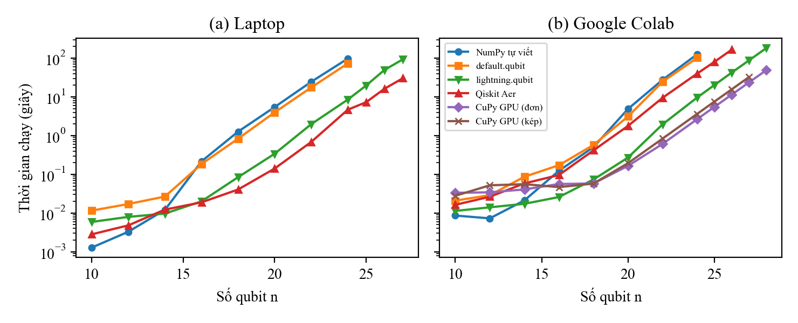

# Tham-Luan-Quantum

**Sinh viên mô phỏng được bao nhiêu qubit?**
Mã đo, sổ tay Colab và dữ liệu thô của tham luận gửi Hội thảo *"Định hướng phát triển công nghệ lượng tử tại TP. Hồ Chí Minh"* (27/11/2026).

Tác giả: Trương Ngô Phát, Ngô Dương Hà. Trường Đại học Công Thương TP. Hồ Chí Minh.



## Câu hỏi và cách trả lời

Sinh viên học lượng tử chủ yếu thực hành bằng mô phỏng trên laptop hoặc Google Colab miễn phí. Hai loại máy này mô phỏng vector trạng thái được đến bao nhiêu qubit, và thư viện nào chạy nhanh nhất?

Chúng tôi chạy cùng một mạch 10 lớp (cổng RY ngẫu nhiên và chuỗi CNOT liền kề) từ 10 đến 28 qubit, trên một laptop và trên Colab, với năm bộ mô phỏng: Qiskit Aer, PennyLane `default.qubit`, PennyLane `lightning.qubit`, NumPy tự viết, và cùng mã đó chạy trên GPU bằng CuPy ở độ chính xác đơn và kép.

## Kết quả chính

Thời gian chạy, tính bằng giây:

| Cấu hình | n = 24 | n = 27 | n = 28 |
|---|---:|---:|---:|
| Laptop, NumPy tự viết | 97,42 | – | – |
| Laptop, Qiskit Aer | 4,67 | 30,16 | – |
| Colab, NumPy tự viết | 126 | – | – |
| Colab, `lightning.qubit` | 9,62 | 87,54 | 182 |
| Colab, CuPy trên GPU T4, độ chính xác đơn | 2,65 | 23,65 | 48,79 |
| Colab, CuPy trên GPU T4, độ chính xác kép | 3,64 | 32,47 | lỗi bộ nhớ |

Dấu "–" nghĩa là không đo, do đã dừng ở mức thấp hơn vì một lần chạy vượt 90 giây hoặc để tránh cạn RAM.

- Thư viện đã tối ưu nhanh hơn mã NumPy tự viết khoảng 13 đến 21 lần ở 24 qubit.
- Thư viện CPU nhanh nhất phụ thuộc phần cứng: Qiskit Aer trên laptop, `lightning.qubit` trên Colab.
- Bộ nhớ gấp đôi sau mỗi qubit và là giới hạn cứng: 16·2ⁿ byte cho vector trạng thái độ chính xác kép.
- Số qubit lớn nhất chạy được trong các phép đo là 27 trên laptop và 28 trên Colab.

Chi tiết và các giới hạn của phép đo nằm trong bài ở thư mục [`paper/`](paper/).

## Cấu trúc thư mục

| Đường dẫn | Nội dung |
|---|---|
| `bench.py` | Mã đo trên laptop (Windows), gồm cả CuPy. |
| `colab_bench.py` | Mã đo chạy được trên Linux và Colab. Cấu hình bằng biến môi trường `SIMS`, `OUT`, `NMAX`. |
| `notebooks/COLAB_BENCH.ipynb` | Sổ tay Colab thứ nhất: NumPy, `default.qubit`, `lightning.qubit`, CuPy độ chính xác đơn. |
| `notebooks/COLAB_BENCH_2.ipynb` | Sổ tay thứ hai: Aer, `lightning.qubit`, CuPy độ chính xác đơn, chạy lại để kiểm tra độ lặp. |
| `notebooks/COLAB_BENCH_3.ipynb` | Sổ tay thứ ba: CuPy độ chính xác đơn so với kép. |
| `data/bench.json`, `data/extra.log` | Kết quả thô trên laptop. `extra.log` là các dòng JSON của lượt đo thêm ở 25 đến 27 qubit. |
| `data/colab_run1.json`, `colab_run2.json`, `colab_run3.json` | Kết quả thô của ba sổ tay Colab, theo thứ tự trên. |
| `data/colab_gpu.json` | Lượt đo GPU không cho kết quả, giữ lại để minh bạch. |
| `paper/` | Bản tham luận (.docx). |

## Chạy lại

Trên Colab: mở một sổ tay trong `notebooks/`, chọn *Runtime → Change runtime type → T4 GPU* rồi chạy lần lượt các ô.

Trên máy cá nhân:

```bash
pip install numpy psutil qiskit qiskit-aer pennylane pennylane-lightning
python colab_bench.py
```

Chạy riêng một số bộ mô phỏng và đổi tên file kết quả:

```bash
SIMS=aer,pl_lightning OUT=ket_qua.json NMAX=26 python colab_bench.py
```

Các bộ GPU cần thêm `cupy-cuda12x` và một GPU NVIDIA.

## Phương pháp đo

- Mỗi lần đo chạy trong một tiến trình riêng, không tính thời gian nạp thư viện.
- Khởi động nóng ở n = 4. Với n ≤ 18 lấy trung vị của 3 lần, với n ≥ 20 đo 1 lần.
- Mỗi lần chạy giới hạn 240 giây. Khi một lần chạy vượt 90 giây thì không tăng n thêm.
- Kiểm tra tính đúng đắn bằng giá trị kỳ vọng ⟨Z₀⟩ giữa các bộ mô phỏng và giữa hai máy: các bộ 64-bit lệch nhau không quá 4×10⁻¹⁴.

## Phần cứng và phiên bản

| | Laptop | Google Colab (gói miễn phí) |
|---|---|---|
| CPU | Intel Core i7-12650H, 10 nhân 16 luồng | Intel Xeon 2,0 GHz, 2 vCPU |
| RAM | 15,7 GB | 12,7 GB |
| GPU | Không dùng trong kết quả (bị hạn chế điện lúc đo) | NVIDIA Tesla T4, 15 GB |
| Hệ điều hành, Python | Windows 11, 3.11 | Linux, 3.13 |

Cả hai máy dùng Qiskit Aer 0.18.2, PennyLane 0.45.1 (lightning 0.45.0), NumPy 2.4.6, CuPy 14.2.

## Giới hạn

Kết quả chỉ áp dụng cho hai máy trong phiên đo, một họ mạch, không có nhiễu lượng tử. Colab miễn phí không đảm bảo luôn cấp cùng một cấu hình. Chưa thử các thư viện GPU chính thức của Qiskit Aer và PennyLane. Nguyên nhân lỗi ở 28 qubit (độ chính xác kép) và 29 qubit (độ chính xác đơn) trên GPU chưa được xác minh.

## Trích dẫn

N. P. Trương, "Tham-Luan-Quantum: Mã đo, sổ tay Colab và dữ liệu thô cho tham luận," GitHub, 2026. [Online]. Available: https://github.com/ngophatneknha/Tham-Luan-Quantum
